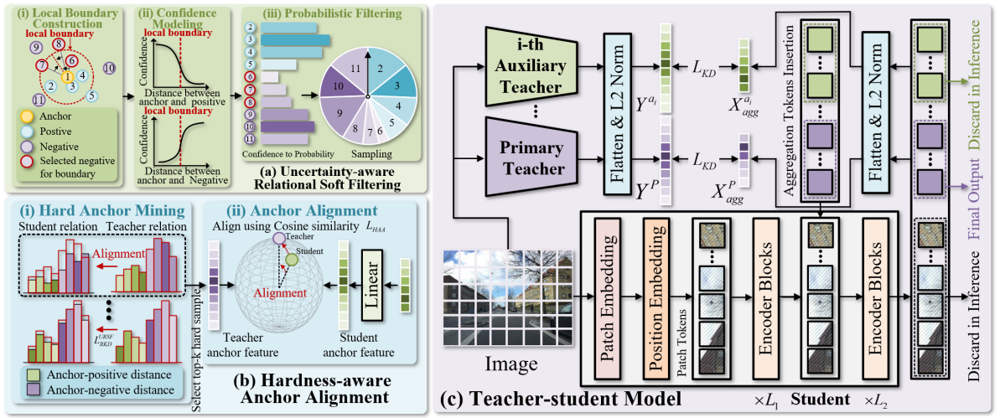

# RelaVPR: Relation-Based Knowledge Distillation for Efficient Visual Place Recognition

Official implementation of **RelaVPR: Relation-Based Knowledge Distillation for Efficient Visual Place Recognition**.

**Zheyuan Zhang, Jiwei Zhang, Rongjing Cai, Nihua Shrestha, Zilong Wang, Boyu Zhou, and Hong Chen**

[Paper](541_RelaVPR_Relation_Based_Kno.pdf) · [Repository](https://github.com/tony19980810/RelaVPR)

> **Release status:** This repository includes the core distillation loss, single-teacher and two-teacher distillation scripts, student models, and evaluation code. Public download links for the RelaVPR checkpoints will be added when available. Training and evaluation require external datasets and matching pretrained weights.

## Overview

Visual foundation models provide strong generalization for Visual Place Recognition (VPR), but their size and inference cost limit practical deployment. RelaVPR transfers knowledge from larger VPR teachers into a lightweight DINOv2-S student through relation-based knowledge distillation, without additional post-distillation fine-tuning.

Our framework combines:

- **Uncertainty-aware Relational Soft Filtering (URSF):** confidence-guided sampling softly filters unreliable teacher relations.
- **Hardness-aware Anchor Alignment (HAA):** additional cosine alignment helps the student learn hard anchors.
- **Decoupled multi-teacher distillation:** separate aggregation-token groups receive supervision from different teachers, reducing interference between their learning objectives.

The student uses implicit aggregation and produces an **L2-normalized, 3072-dimensional descriptor** with approximately **22.1M parameters**. The single-teacher variant uses ImAge; the two-teacher variant uses ImAge as its primary teacher and EDTformer as its auxiliary teacher. During two-teacher evaluation, only the primary teacher's token group supplies the retrieval descriptor; the two descriptors are not concatenated or fused.



## Results

Results below are reported in **Table 1 of the paper**, not newly reproduced by this repository preparation. Recall values are percentages. Input resolution is part of the evaluation protocol and must be matched when comparing results.

### Evaluation at 224 × 224

| Model | Dataset | R@1 | R@5 | R@10 |
| :--- | :--- | ---: | ---: | ---: |
| Single-teacher | Pitts30k | 92.5 | 96.6 | 97.7 |
| Single-teacher | MSLS-val | 93.0 | 96.1 | 96.6 |
| Single-teacher | SPED | 89.3 | 93.9 | 95.1 |
| Single-teacher | Pitts250k | 94.9 | 98.5 | 99.2 |
| Single-teacher | AmsterTime | 52.8 | 73.8 | 79.4 |
| Single-teacher | Nordland | 89.4 | 96.0 | 97.5 |
| Two-teacher | Pitts30k | 92.6 | 96.4 | 97.4 |
| Two-teacher | MSLS-val | 92.2 | 96.4 | 96.8 |
| Two-teacher | SPED | 89.8 | 94.6 | 95.4 |
| Two-teacher | Pitts250k | 95.0 | 98.7 | 99.3 |
| Two-teacher | AmsterTime | 53.2 | 74.3 | 79.9 |
| Two-teacher | Nordland | 86.1 | 94.3 | 96.3 |

### Evaluation at 322 × 322

| Model | Dataset | R@1 | R@5 | R@10 |
| :--- | :--- | ---: | ---: | ---: |
| Single-teacher | Pitts30k | 92.6 | 96.9 | 97.8 |
| Single-teacher | MSLS-val | 92.8 | 96.8 | 97.6 |
| Single-teacher | SPED | 89.8 | 94.2 | 94.6 |
| Single-teacher | Pitts250k | 95.1 | 98.8 | 99.4 |
| Single-teacher | AmsterTime | 56.9 | 77.2 | 82.4 |
| Single-teacher | Nordland | 93.7 | 97.7 | 98.6 |

## Setup

Run commands from the repository root. A CUDA-enabled PyTorch installation is recommended for benchmark evaluation. Install a matching PyTorch/torchvision pair for your system, then install the evaluation dependencies:

```bash
python -m pip install torch torchvision
python -m pip install "numpy<2" pillow tqdm scikit-learn faiss-cpu timm
```

This is a minimal dependency guide inferred from the imports, not a pinned, validated reproduction environment. NumPy is kept below 2 because the current evaluation code uses `np.in1d`. For distillation, also install:

```bash
python -m pip install pandas pytorch-metric-learning
```

**Attention backend:** xFormers is disabled in the shared RelaVPR attention/block implementation. Both student variants use standard PyTorch attention, even when xFormers is installed; no environment variable is required. This avoids a return-value inconsistency in the optional xFormers path that can affect batched inference. Nested/list-input attention requiring xFormers is not supported in this configuration.

## Dataset Preparation

We use [GSV-Cities](https://github.com/amaralibey/gsv-cities) for training in the paper. For evaluation, follow the dataset preparation conventions of the [Visual Geo-localization Benchmark](https://github.com/gmberton/deep-visual-geo-localization-benchmark) and [VPR-datasets-downloader](https://github.com/gmberton/VPR-datasets-downloader).

The evaluator expects the following layout, including `images/test` for the prepared `msls_val` directory:

```text
datasets/
├── pitts30k/images/test/
│   ├── database/
│   └── queries/
├── pitts250k/images/test/
│   ├── database/
│   └── queries/
├── msls_val/images/test/
│   ├── database/
│   └── queries/
├── sped/images/test/{database,queries}/
├── amstertime/images/test/{database,queries}/
├── nordland/images/test/{database,queries}/
├── svox_sun/images/test/{database,queries}/
├── svox_rain/images/test/{database,queries}/
└── svox_night/images/test/{database,queries}/
```

Braces abbreviate two separate directories. Images must be `.jpg` files with benchmark-compatible filenames containing coordinates, such as `@utm_easting@utm_northing@...@.jpg`. Keep the prepared benchmark ground-truth encoding intact, especially for sequence-based datasets. The loader derives positive matches from those coordinates and `--val_positive_dist_threshold` (default: 25).

## Model Weights

Place the following files in the repository root:

| File | Purpose | Availability |
| :--- | :--- | :--- |
| `dinov2_vits14_reg4_pretrain_register.pth` | DINOv2-S/14 backbone with four register tokens | Obtain the matching backbone state dictionary |
| `RelaVPR_single.pth` | Single-teacher student | Public link pending |
| `RelaVPR_two_teacher.pth` | Two-teacher student | Public link pending |

The filenames above are required by the current implementation. Both network constructors load the backbone file before loading the RelaVPR checkpoint. The evaluator expects the RelaVPR checkpoint to contain a `model_state_dict` key. A full student checkpoint includes the aggregation tokens; a backbone-only checkpoint cannot replace it. Only load checkpoint files from trusted sources.

Teacher checkpoints are not needed for evaluation.

## Distillation

`loss.py` contains the core URSF/HAA implementation (`RKDConfidenceHardLoss_final`). Both training entry points are included:

```bash
# Single-teacher distillation (ImAge)
python distillation.py

# Two-teacher distillation (ImAge + EDTformer)
python distillation_two_teacher.py
```

Before running either script:

1. Prepare GSV-Cities with its `Dataframes/` and image directories. Set `BASE_PATH` in `dataloaders/train/GSVCitiesDataset.py` to the dataset root, including a trailing path separator. The current module checks this path when imported.
2. Prepare Pitts30k validation images under `pitts30k/images/val/{database,queries}` and the prepared MSLS validation data under `msls_val/images/test/{database,queries}`. Set the evaluation root in the corresponding student parser.
3. Place the student backbone weights listed above, the ImAge backbone weights (`dinov2_vitb14_reg4_pretrain.pth`), and the ImAge teacher checkpoint (`ImAge_Merged.pth`) at their configured paths. The ImAge paths are defined in `parser_ImAge.py`. Two-teacher distillation additionally loads `./EDTformer.pth`.
4. Review the parser defaults and the hardcoded `CUDA_VISIBLE_DEVICES` setting in the selected script. The scripts parse the same command line separately for teacher and student; configure their distinct backbone paths in the parser defaults to avoid overriding both with one shared argument.

The paper trains with four images per place at **224 × 224** and a batch size of **24 places**. The current loader uses **266 × 266**, and the two-teacher parser defaults to **14 places**. Set `image_size` in `dataloaders/GSVCities.py` and the student batch-size default to the intended protocol before attempting reproduction; `--resize` controls validation preprocessing, not this training transform.

Checkpoints and logs are saved under `logs/`. Best-model selection currently uses the sum of Pitts30k-val and MSLS-val R@1; some log messages incorrectly call this R@5. The saved student parameters support evaluation, but the training checkpoints do not include the learnable distillation-head parameters needed for exact training resumption. No separate fine-tuning stage is required by RelaVPR.

## Evaluation

The current scripts iterate over the `places` list defined near the start of each file. **Before running, set this list to the datasets you have prepared.** For example, use `places = ['pitts30k']` to evaluate only Pitts30k. The parsed `--eval_dataset_name` option does not select datasets in these scripts.

Evaluate the single-teacher student at 322 × 322:

```bash
python eval.py --eval_datasets_folder /path/to/datasets --resize 322 322 --infer_batch_size 64 --test_method hard_resize --recall_values 1 5 10
```

To reproduce the 224 × 224 protocol, change `--resize`:

```bash
python eval.py --eval_datasets_folder /path/to/datasets --resize 224 224 --infer_batch_size 64 --test_method hard_resize --recall_values 1 5 10
```

Evaluate the two-teacher student at 224 × 224:

```bash
python eval_two_teacher.py --eval_datasets_folder /path/to/datasets --resize 224 224 --infer_batch_size 64 --test_method hard_resize --recall_values 1 5 10
```

Use your own dataset path, including a quoted Windows path if applicable. Keep the default DINOv2 backbone, no explicit aggregator, and 8 / 16 aggregation tokens for single- / two-teacher checkpoints, respectively. Other parser options include experimental or incomplete paths and are not covered by these commands. In particular, avoid `nearest_crop`, `maj_voting`, and `--efficient_ram_testing` until their issues are resolved.

Results are written to `RelaVPR.txt` or `RelaVPR_two_teacher.txt`; each run overwrites the corresponding summary. Logs are created under `test/`. The scripts currently force visible GPU `0`; edit `CUDA_VISIBLE_DEVICES` inside the script if necessary. Checkpoint loading currently lacks `map_location`, so `--device cpu` alone may not load a checkpoint saved on CUDA.

## Code Layout

```text
distillation.py                 # Single-teacher distillation entry point
distillation_two_teacher.py     # Two-teacher distillation entry point
loss.py                         # Core relational distillation loss (URSF/HAA)
eval.py                         # Single-teacher evaluation entry point
eval_two_teacher.py             # Two-teacher evaluation entry point
network_RelaVPR.py              # Single-teacher student
network_RelaVPR_two_teacher.py  # Two-teacher student
parser_RelaVPR.py               # Single-teacher arguments
parser_RelaVPR_two_teacher.py   # Two-teacher arguments
test.py / test_two_teacher.py   # Descriptor extraction and recall evaluation
datasets_ws.py                 # Evaluation dataset loader
backbone/                      # Transformer backbones and supporting layers
aggregators/                   # Aggregator implementations (not used by default)
assets/                        # Paper framework illustration
```

## Acknowledgements

We thank the authors of [DINOv2](https://github.com/facebookresearch/dinov2), ImAge, [EDTformer](https://github.com/Tong-Jin01/EDTformer), [CricaVPR](https://github.com/Lu-Feng/CricaVPR), [BoQ](https://github.com/amaralibey/Bag-of-Queries), and [SALAD](https://github.com/serizba/salad) for their contributions. We also thank [GSV-Cities](https://github.com/amaralibey/gsv-cities), the [Visual Geo-localization Benchmark](https://github.com/gmberton/deep-visual-geo-localization-benchmark), and [VPR-datasets-downloader](https://github.com/gmberton/VPR-datasets-downloader) for their dataset and evaluation resources.

Third-party code retains its original copyright and license notices. See the relevant source headers and `backbone/LICENSE`; a repository-wide license has not yet been specified.

## Citation

If you find this work useful, please cite our manuscript:

```bibtex
@misc{zhang2026relavpr,
  title  = {RelaVPR: Relation-Based Knowledge Distillation for Efficient Visual Place Recognition},
  author = {Zhang, Zheyuan and Zhang, Jiwei and Cai, Rongjing and Shrestha, Nihua and Wang, Zilong and Zhou, Boyu and Chen, Hong},
  year   = {2026}
}
```
